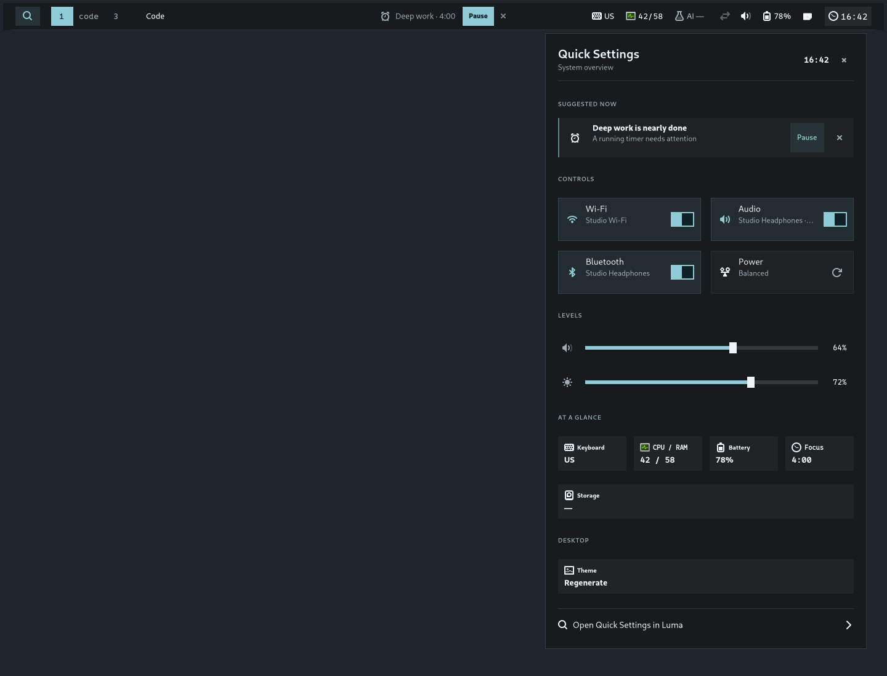
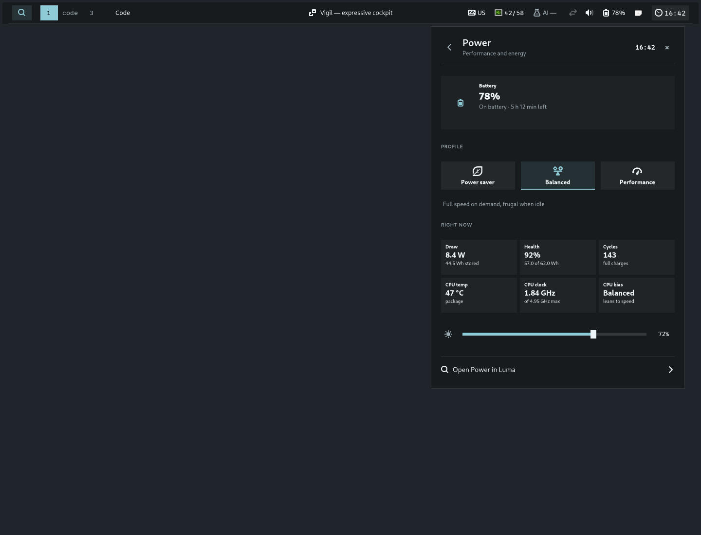

# Vigil

A desktop bar and notification center for Hyprland and Niri. Includes workspaces,
media controls, timers, quick settings, and system status.

## Setup

Requires Rust, a C compiler, `pkg-config`, GTK 4.20+, and gtk4-layer-shell.
Install their development packages before building. The stylesheet uses Cantarell
and Symbols Nerd Font.

```sh
git clone https://github.com/robinp7720/Vigil.git
cd Vigil
cargo build --release --locked
install -Dm755 target/release/vigil ~/.local/bin/vigil
mkdir -p ~/.config/vigil
cp config.example.toml ~/.config/vigil/config.toml
curl -fL https://raw.githubusercontent.com/robinp7720/dotfiles/master/bar/style.css \
  -o ~/.config/vigil/style.css
```

Set `primary_output` in `~/.config/vigil/config.toml` to your monitor name
(`hyprctl monitors` or `niri msg outputs`). Run `~/.local/bin/vigil` from your
Wayland session, then add it to your compositor's startup configuration.
Add `~/.local/bin` to your `PATH` to use the commands below.
Vigil provides notifications, so stop any other notification daemon first.

Audio uses `wpctl` and `pactl`; media uses `playerctl`; network controls use
NetworkManager. Bluetooth and power profiles use BlueZ and power-profiles-daemon.
Install `brightnessctl` for backlight controls and [Luma](https://github.com/robinp7720/Luma)
for desktop search.

## Usage

Click the bar's status icons to open quick settings, or run:

```sh
vigil control-center toggle
vigil timer start 25m --label Focus
vigil media play-pause
```

Configuration options are in [config.example.toml](config.example.toml).
Edit `~/.config/vigil/style.css` for styling; an optional `colors.css` overrides
the palette. Run `vigil --help` for more commands.

## Screenshots

Example config and the stylesheet installed above, with sample status data.




